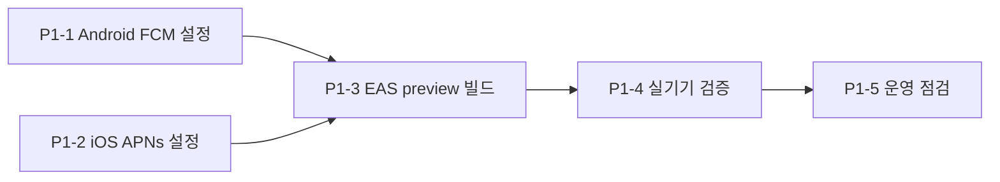

# 남은 작업 정리 — P1(모바일 푸시 실사용화) · P3(기능)

작성일: 2026-10-05
범위: P0(보안 정리)·P2(운영/인프라)는 이 문서에서 제외한다.
근거: 2026-10-05 기준 `surplus-hub-react@main(ad12900)`, `surplus-hub-api-v3@main(208e816)` 코드와 운영 엔드포인트 응답을 직접 확인한 결과.

---

## 0. 현재 상태 요약

| 항목 | 상태 | 확인 방법 |
|---|---|---|
| 백엔드 푸시 발송(Expo/FCM 분기, 무효 토큰 정리) | 코드·테스트 완료, 운영 배포됨 | 운영 `/api/v1/notifications/preferences` → 401 (없는 경로는 404) |
| 관리자 푸시 발송 콘솔 (웹) | 운영 배포됨 | `/admin/notifications` → 200 |
| 모바일 푸시 수신 코드 (`usePushNotifications.ts`) | 코드 완료 (게시글 딥링크 포함) | 단위 테스트 통과 |
| Android FCM 설정 | **완료 (2026-10-24)** | Firebase `surplus-502901` 앱(`1:131608276147:android:4d2c099cb1c90a62eb14c6`) 생성, `GOOGLE_SERVICES_JSON` EAS 파일 시크릿 및 FCM V1 서비스 계정 키(`d19c5460-2d1e-47a4-98eb-e0e2000d3ba7`) EAS 등록 완료 |
| iOS APNs 설정 | **미완료** (`aps-environment` 분기는 `app.config.js`에 구현됨) | Apple Developer($99/년) 로그인 및 APNs 키 등록 필요 |
| EAS 빌드 | **Android preview APK 빌드 실행 완료 (2026-10-24)** | Build ID: `907a3aef-6844-4f52-be52-f83bf6b6e122` (`@seongchae/surplus-hub-mobile`) |

> 결론: 서버는 보낼 준비가 끝났지만, **앱이 실제 푸시 토큰을 받는 경로(FCM/APNs)가 아직 열려 있지 않다.** P1이 끝나기 전까지 모바일 푸시는 동작하지 않는다.

---

## P1. 모바일 푸시 실사용화

### P1-1. Android — FCM 연결 (✅ 완료: 2026-10-24)

Expo Push Service도 Android 기기에는 FCM을 거쳐 전달한다. 앱 쪽 설정과 서버 쪽 자격증명이 **둘 다** 있어야 한다.

| # | 작업 | 상태 | 비고 |
|---|---|---|---|
| 1 | Firebase 콘솔/API에서 Android 앱 등록 (패키지 `com.surplushub.mobile`) | ✅ 완료 | GCP `surplus-502901` 프로젝트에 등록 (App ID: `1:131608276147:android:4d2c099cb1c90a62eb14c6`) |
| 2 | `google-services.json` 다운로드 및 EAS file secret 주입 | ✅ 완료 | 로컬 다운로드 및 `.gitignore` 등록, EAS file secret `GOOGLE_SERVICES_JSON` 등록 완료 |
| 3 | `app.config.js`에 `googleServicesFile` 동적 경로 연결 | ✅ 완료 | `process.env.GOOGLE_SERVICES_JSON` 또는 로컬 `./google-services.json` 자동 fallback |
| 4 | Firebase 서비스 계정 키 발급 및 EAS FCM V1 키 등록 | ✅ 완료 | `firebase-adminsdk-fbsvc` 키 발급 후 EAS Android Credentials FCM V1 키(`d19c5460-2d1e-47a4-98eb-e0e2000d3ba7`) 등록 |

> [!NOTE]
> `google-services.json`은 공개 레포지토리에 커밋되지 않도록 `.gitignore`에 등록되었으며, EAS 빌드 서버에는 EAS file secret(`GOOGLE_SERVICES_JSON`)으로 안전하게 전달된다. FCM V1 서비스 계정 키 역시 EAS Credentials Vault에 등록 후 로컬 임시 파일은 즉시 파기되었다.

### P1-2. iOS — APNs 연결

| # | 작업 | 담당 | 비고 |
|---|---|---|---|
| 1 | Apple Developer Program 가입 ($99/년) | 사용자 | iOS 실기기 푸시의 전제 조건 |
| 2 | `eas credentials` 또는 첫 `eas build -p ios` 때 Apple 로그인 → Push Key 자동 생성/등록 | 사용자 (대화형) | |
| 3 | `aps-environment` 확인 | 완료 | `app.config.js`가 preview/production 프로필에서 `production`으로 설정. 이게 틀리면 운영 푸시가 조용히 전부 실패하므로 이미 처리해 둔 상태 |

### P1-3. EAS preview 빌드 (Android 빌드 완료)

- **Android Preview APK**: ✅ 빌드 큐 등록 완료 (2026-10-24)
  - 빌드 프로파일: `preview` (`APS_ENVIRONMENT=production`, 운영 API `surplus-hub-api-v3-production.up.railway.app`, `buildType: apk`)
  - Build ID: `907a3aef-6844-4f52-be52-f83bf6b6e122`
  - 빌드 로그 및 다운로드 링크: https://expo.dev/accounts/seongchae/projects/surplus-hub-mobile/builds/907a3aef-6844-4f52-be52-f83bf6b6e122
- **iOS Preview ad-hoc**: 사용자 Apple 계정 대화형 로그인 후 실행 필요
  - 실행 명령: `cd surplus-hub-react/apps/mobile && npx eas build --profile preview --platform ios`

### P1-4. 실기기 검증 체크리스트

관리자 콘솔(`/admin/notifications`)에서 대상을 "특정 사용자"로 지정해 발송하며 확인한다.

| # | 시나리오 | 기대 결과 |
|---|---|---|
| 1 | 첫 로그인 | 권한 요청 → 허용 시 서버 `device_tokens`에 `ExponentPushToken[...]` 등록 |
| 2 | 앱 **포그라운드**에서 수신 | 배너 표시 + 알림 목록·미읽음 수 갱신 |
| 3 | 앱 **백그라운드**에서 수신 → 탭 | 채팅이면 `/chat/{id}`, 자재면 `/material/{id}`로 이동 |
| 4 | 앱 **종료 상태**에서 탭 (cold start) | 앱 실행 후 해당 화면으로 이동 (`handleColdStartResponse`) |
| 5 | 홈 마스트헤드 배지 | 미읽음 수와 일치 |
| 6 | 알림 설정 화면에서 "채팅" OFF → 채팅 발생 | 인앱 알림은 생기고 **푸시는 안 옴** |
| 7 | 마케팅 수신 ON/OFF | 기본 OFF, ON 시 `push_marketing_consented_at` 기록 |
| 8 | 로그아웃 | 서버에서 토큰 해제 (실패 시 다음 실행 때 재시도) |
| 9 | 앱 삭제 후 발송 | Expo가 `DeviceNotRegistered` 반환 → 서버가 토큰 비활성화 |
| 10 | Android 알림 채널 | `default` 채널, 강조색 `#ed701d` |

> [!NOTE]
> **커뮤니티 게시글 알림(댓글 등) 딥링크 구현 완료 (2026-10-23):** 모바일 게시글 상세 화면(`apps/mobile/app/community/[id].tsx`) 추가 및 `notificationRoute()`의 `post` 타깃 라우팅(`/community/{id}`) 연결이 완료되었다.

### P1-5. 운영 점검 (✅ 완료: 2026-10-24)

- ✅ 운영 DB에 `push_prefs_001` 마이그레이션 컬럼 생성 및 동작 검증 완료:
  - Railway 운영 엔드포인트 `GET /api/v1/notifications/preferences` 인증 호출 시 `200 OK` 및 `{"pushEnabled":true,"pushChat":true,"pushMaterial":true,"pushCommunity":true,"pushMarketing":false}` 정상 반환 확인.
- Sentry에서 `feature: push` 태그 이벤트 모니터링 — 토큰 발급 실패가 여기로 모인다.
- (선택) Expo 대시보드 Push Security 활성화 시 `EXPO_ACCESS_TOKEN`을 Railway 환경변수에 설정.

### P1 완료 기준
- Android·iOS 각 1대 이상에서 체크리스트 1~9 통과
- 결과를 이 문서 하단 또는 별도 검증 기록으로 남김

---

## P3. 기능 작업

| ID | 작업 | 상태 | 성격 | 선행 조건 | 규모(추정) |
|---|---|---|---|---|---|
| P3-1 | 채팅방 상단 자재 미니 카드 | ✅ 완료 (2026-10-23, 운영 배포됨) | 개발만으로 가능 | 없음 | 소 (0.5~1일) |
| P3-2 | 모바일 커뮤니티 게시글 상세 화면 | ✅ 완료 (2026-10-23, 코드 반영됨) | 개발만으로 가능 | 없음 | 중 (1~2일) |
| P3-3 | 사업자 인증 | ✅ 완료 (2026-10-24, 운영 배포됨) | B2B 신뢰도 핵심 | 10자리 사업자등록번호 체크섬 검증 + 배지 시스템 | 중 (완료) |
| P3-4 | PG 결제 · 에스크로 · 정산 · 세금계산서 | 대기 | PRD Phase 3 (§3.9) | **사업·법무 결정, PG 가맹 심사** | 대 (PRD 기준 5~8주 단계) |

### P3-1. 채팅방 상단 자재 미니 카드 — ✅ 완료 (2026-10-23)

- **백엔드(`surplus-hub-api-v3`)**: `GET /api/v1/chats/rooms/{room_id}` 단건 조회 엔드포인트 추가 및 `ChatRoom` 응답 스키마에 `materialPrice`, `materialStatus`, `materialImageUrl` 필드 확장 (`app/tests/api/test_chats.py` 15개 테스트 통과, Railway 운영 배포 완료).
- **프론트엔드(`surplus-hub-react`)**: `@repo/core`에 `fetchChatRoom`, `useChatRoomDetail` 추가, 웹(`apps/web/src/app/chat/[id]/page.tsx`) 및 모바일(`apps/mobile/app/(tabs)/chat/[id].tsx`) 채팅방 상단에 썸네일·제목·가격·상태 배지(판매중/예약중/판매완료) 미니 카드 및 삭제된 자재 폴백 UI 반영 (Jest 테스트 통과, Vercel 운영 배포 완료).

### P3-2. 모바일 커뮤니티 게시글 상세 화면 — ✅ 완료 (2026-10-23)

- **모바일 화면(`apps/mobile/app/community/[id].tsx`)**: 게시글 본문, 조회수, 좋아요 토글(`useTogglePostLike`), 댓글 목록 및 작성/삭제(`useComments`, `useCreateComment`, `useDeleteComment`) 구현 및 `apps/mobile/app/_layout.tsx` 스택 등록, `(tabs)/community.tsx` 카드 터치 라우팅 연결 완료.
- **푸시 딥링크(`apps/mobile/hooks/usePushNotifications.ts`)**: `notificationRoute()`에서 `target.kind === "post"`일 때 `/community/${target.id}`를 반환하도록 업데이트 및 단위 테스트(`usePushNotifications.test.js`) 통과.

### P3-3. 사업자 인증 — ✅ 완료 (2026-10-24)

- **백엔드(`surplus-hub-api-v3`)**:
  - `POST /api/v1/users/me/verify-business` 엔드포인트 구현 (`app/api/endpoints/users.py`): 대한민국 10자리 사업자등록번호 공식 가중치 체크섬(`[1, 3, 7, 1, 3, 7, 1, 3, 5]`) 검증을 통과하면 `trust_level = 85` 승격 및 최초 인증 시 매너온도 `+1.5°C` 부여.
  - `app/schemas/material.py`의 `Seller` 스키마에 `trust_level` (`trustLevel`) 필드를 노출하여 자재 목록/상세 조회 시 판매자 사업자 인증 여부를 함께 전달.
- **프론트엔드·모바일(`surplus-hub-react`)**:
  - `@repo/core`에 `verifyBusiness` API 및 `useVerifyBusiness` 훅 추가, `MaterialItem.sellerTrustLevel` 매핑.
  - 웹 자재 상세(`apps/web/src/app/material/[id]/page.tsx`) 판매자 프로필에 `sellerTrustLevel >= 80`일 때 **`사업자 인증`** 배지 노출.
  - 웹 프로필(`/profile`, `/profile/edit`) 및 모바일 프로필(`apps/mobile/app/(tabs)/profile.tsx`)에 B2B 사업자등록번호 인증 UI 추가 및 신규 가입자(`trust_level = 1`)가 `"관리 필요"`로 잘못 표시되던 등급 버그를 `"일반 회원"` / `"사업자 인증 완료"`로 수정.
- **운영 시드 반영**: 운영 DB의 4대 B2B 판매처 계정(`(주)반월철강자재`, `온수산단전설`, `시화배관자재`, `성수인테리어하우징`)에 사업자 인증 완료 처리하여 12종 전체 매물에 **`사업자 인증`** 배지 노출.

### P3-4. PG 결제 · 에스크로 · 정산 · 세금계산서 (PRD §3.9)

PRD에 요구사항(R-9.1~R-9.6), API, DB 스키마(`payments`, `settlements`, `commission_settings`) 초안이 이미 있다. 현재는 "거래 금액 기록만 가능, 실결제 없음".

**개발보다 먼저 정해야 할 것**

| 결정 사항 | 왜 먼저인가 |
|---|---|
| PG사 선택 (PRD 후보: 토스페이먼츠 / 나이스페이) | SDK·웹훅 구조가 PG마다 다르다 |
| 사업자등록 · 통신판매업 신고 · PG 가맹 심사 | 심사 통과 전에는 실결제 테스트 불가 |
| 수수료율 · 정산 주기 | `commission_settings`, 정산 배치 설계에 필요 |
| 에스크로 구매확정 규칙 (자동확정 기한 등) | `payments.status` 전이 규칙을 결정 |
| 세금계산서 발행 주체 (플랫폼 vs 판매자) | R-9.6 구현 방식이 완전히 달라진다 — 세무 검토 필요 |

**개발 단계 (결정 이후)**
1. `payments` 모델 + PG 결제 준비·확인·취소 API (샌드박스)
2. 에스크로 상태 전이 + 구매확정 / 자동확정 배치
3. 수수료 설정 + 정산 집계 + 관리자 정산 화면
4. 세금계산서 연동 (PRD상 P2)

---

## 진행 순서 제안

1. **P1-1 / P1-2** — 사용자 계정 작업(Firebase, Apple)이 필요하므로 먼저 시작
2. 그 사이 **P3-1** (자재 미니 카드, 권장안 B) 개발
3. **P1-3 / P1-4** — 빌드 후 실기기 검증, P3-1을 함께 확인
4. **P3-2** — 커뮤니티 상세 → 댓글 푸시 딥링크 완성
5. **P3-3 / P3-4** — 기획·사업 결정이 나오는 대로 착수
